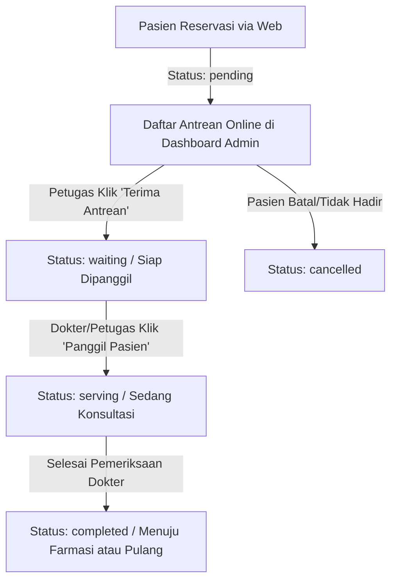

# 🏥 RS Qless Medika - Sistem Antrean & Janji Temu Dokter Digital

Aplikasi web modern manajemen antrean poliklinik dan reservasi janji temu dokter berbasis **React + Vite**. Dirancang dengan arsitektur UI/UX berstandar rumah sakit, mendukung pemisahan hak akses antara **Pasien (User)** dan **Petugas Loket (Admin)** secara independen.

---

## 📌 Daftar Isi
- [Fitur Utama](#-fitur-utama)
- [Arsitektur Autentikasi & Akun](#-arsitektur-autentikasi--akun)
- [Alur Kerja Antrean (Queue Workflow)](#-alur-kerja-antrean-queue-workflow)
- [Teknologi yang Digunakan](#-teknologi-yang-digunakan)
- [Struktur Direktori Proyek](#-struktur-direktori-proyek)
- [Panduan Instalasi & Menjalankan Proyek](#-panduan-instalasi--menjalankan-proyek)
- [Rute Halaman (Routing Architecture)](#-rute-halaman-routing-architecture)
- [Konvensi Kode & Styling](#-konvensi-kode--styling)

---

## ✨ Fitur Utama

### 1. 🧑‍🤝‍🧑 Portal Pasien (Public & Patient)
- **Beranda Interaktif**: Ringkasan poliklinik, dokter spesialis, statistik antrean live, dan widget booking cepat.
- **Reservasi Janji Temu (`/appointment`)**:
  - Pemilihan spesialisasi dan dokter poliklinik.
  - *Time Slot Picker* interaktif untuk jam konsultasi.
  - Pengisian data identitas (NIK, No. HP, Metode Pembayaran: BPJS, Asuransi, Umum).
  - Konfirmasi instan & penerbitan **E-Tiket Antrean** digital.
- **Monitor Antrean Publik (`/queue`)**:
  - Tampilan monitor antrean poliklinik real-time.
  - Filter pencarian tiket, status kuota, dan estimasi waktu tunggu.
  - Pratinjau detail tiket dengan modal cetak / simpan.
- **Direktori Dokter (`/doctors`)**: Filter dokter berdasarkan spesialisasi & jadwal praktik.
- **Informasi Rumah Sakit**: Profil RS (`/about`), Galeri Fasilitas dengan Lightbox (`/gallery`), Artikel Kesehatan (`/blog`), dan Form Kontak (`/contact`).

### 2. 🛡️ Portal Administrator Loket (`/admin`)
- **Dashboard Operasional Khusus**:
  - **KPI Ringkasan Real-Time**: Total terdaftar, antrean pending, siap panggil, sedang dilayani, dan selesai.
  - **Validasi Kehadiran Pasien**: Antrean online yang masuk berstatus `pending` dapat diverifikasi dan diterima (*Accept*) sebelum masuk urutan panggil dokter.
  - **Pemanggilan Pasien (*Voice / Screen Call*)**: Memanggil nomor tiket ke ruang konsultasi dokter (`waiting` ➔ `serving`).
  - **Penyelesaian Layanan**: Menandai konsultasi selesai (`serving` ➔ `completed`).
  - **Pembatalan Tiket**: Opsi pembatalan/penolakan antrean jika pasien tidak hadir atau berhalangan.
  - **Pencarian Cepat**: Berdasarkan Kode Booking (`QLS-...`), Nomor Antrean (`A-028`), Nama Pasien, atau NIK.
  - **Filter Poliklinik**: Pengelompokan antrean per ruang poli atau menampilkan seluruh poli.
  - **Reset Demo Data**: Tombol muat ulang data simulasi antrean demo ke kondisi awal.

---

## 🔐 Arsitektur Autentikasi & Akun

Sistem autentikasi sengaja dipisahkan secara terisolasi agar data pasien tidak bercampur dengan akun petugas loket:

| Role | Portal Login | Kredensial Default | Penyimpanan Sesi | Deskripsi Akses |
| :--- | :--- | :--- | :--- | :--- |
| **Admin Loket** | `/admin/login` | **Email**: `adminganz123@gmail.com`<br>**Password**: `ladeshgimank` | `localStorage: qless_admin` | Akses penuh ke `/admin` untuk memvalidasi antrean online, memanggil pasien, dan menyelesaikan layanan poli. |
| **Pasien (User)** | `/login` & `/register` | **Email Demo**: `hendra.wijaya@gmail.com`<br>**Password**: `qlessMedika123`<br>*(Atau daftar mandiri)* | `localStorage: qless_user` | Melakukan reservasi janji temu dokter, melacak nomor antrean pribadi, dan menyimpan riwayat tiket. |

### 🛡️ Proteksi Keamanan Silang (Cross-Auth Guard):
1. **Route Guard `/admin`**: Jika pengguna belum login sebagai admin, sistem secara otomatis me-redirect ke `/admin/login`.
2. **Pencegahan Login Admin di Form Pasien**: Jika email admin (`adminganz123@gmail.com`) dimasukkan ke halaman login pasien (`/login`), sistem akan menolak dan menampilkan tautan langsung ke portal resmi admin.
3. **Pencegahan Registrasi**: Email admin diblokir dari formulir pendaftaran pasien baru (`/register`).
4. **Isolasi Logout**: Logout akun pasien tidak akan memutus sesi admin, dan sebaliknya.

---

## 🔄 Alur Kerja Antrean (Queue Workflow)



1. **Pending**: Pasien mendaftar online. Tiket belum masuk antrean panggil ruang dokter sampai dikonfirmasi oleh petugas loket.
2. **Waiting**: Pasien telah terverifikasi hadir di rumah sakit, siap dipanggil saat giliran tiba.
3. **Serving**: Pasien sedang berada di dalam ruang dokter untuk pemeriksaan medis.
4. **Completed**: Layanan konsultasi selesai, pasien dapat mengambil resep atau menyelesaikan administrasi.

---

## 🛠️ Teknologi yang Digunakan

- **Core**: [React 19](https://react.dev/) + [Vite 8](https://vitejs.dev/)
- **Routing**: [React Router DOM v7](https://reactrouter.com/)
- **Icons**: [Lucide React](https://lucide.dev/)
- **Styling**: Vanilla CSS murni dengan arsitektur **Design Tokens** (`tokens.css`) tanpa framework utilitas eksternal, mendukung mode terang/gelap (Dark/Light Mode).
- **Animasi & Interaksi**: CSS Transitions, Scroll-Direction detection hook, intersection observer (`useInView`), dan `canvas-confetti`.
- **State Management**: React Context API (`AuthContext` & `QueueContext`) yang tersinkronisasi otomatis dengan browser `localStorage`.

---

## 📂 Struktur Direktori Proyek

```text
QLess-Hospital queue/
├── public/                  # Asset statis publik
├── src/
│   ├── components/
│   │   ├── common/          # Komponen UI dasar (Button, Card, Badge, FormField, Counter, Lightbox, dll.)
│   │   ├── layout/          # Layout wrappers (Navbar floating pill, Footer, Layout)
│   │   └── queue/           # Komponen antrean (LiveQueueCard, TicketCard, TimeSlotPicker)
│   ├── context/
│   │   ├── AuthContext.jsx  # State autentikasi terpisah (Patient: qless_user, Admin: qless_admin)
│   │   └── QueueContext.jsx # Pengelolaan state tiket, penerimaan antrean, dan alur panggil
│   ├── data/
│   │   ├── hospitalData.js  # Data poliklinik, layanan medis, statistik rumah sakit
│   │   ├── doctorsData.js   # Daftar dokter spesialis, jadwal poli, dan rating
│   │   ├── queueData.js     # Data inisial simulasi antrean (pending, waiting, serving, completed)
│   │   ├── galleryData.js   # Koleksi foto fasilitas medis
│   │   └── blogData.js      # Artikel edukasi kesehatan
│   ├── hooks/
│   │   ├── useInView.js          # Intersection observer untuk animasi scroll reveal
│   │   └── useScrollDirection.js # Hook navigasi navbar floating pill
│   ├── pages/
│   │   ├── HomePage.jsx          # Beranda rumah sakit
│   │   ├── AboutPage.jsx         # Tentang RS Qless Medika
│   │   ├── DoctorsPage.jsx       # Direktori dokter spesialis
│   │   ├── QueueTrackerPage.jsx  # Layar publik monitor antrean poliklinik
│   │   ├── AppointmentPage.jsx   # Form reservasi janji temu & penerbitan e-tiket
│   │   ├── AdminDashboardPage.jsx# Dashboard operasional loket antrean (Protected)
│   │   ├── AdminLoginPage.jsx    # Portal login khusus administrator
│   │   ├── LoginPage.jsx         # Login portal pasien
│   │   ├── RegisterPage.jsx      # Pendaftaran akun pasien baru
│   │   ├── GalleryPage.jsx       # Galeri fasilitas rumah sakit
│   │   ├── BlogPage.jsx          # Daftar artikel kesehatan
│   │   ├── BlogDetailPage.jsx    # Detail artikel kesehatan
│   │   ├── ContactPage.jsx       # Kontak & lokasi poliklinik
│   │   ├── PrivacyPage.jsx       # Kebijakan privasi
│   │   └── TermsPage.jsx         # Syarat & ketentuan
│   ├── styles/
│   │   └── tokens.css            # Sistem token CSS (Colors, Typography, Spacing, Shadows, Theme)
│   ├── App.jsx                   # Konfigurasi rute React Router
│   ├── index.css                 # Global styling reset & utilitas
│   └── main.jsx                  # Entry point React
├── package.json                  # Dependensi proyek
└── README.md                     # Dokumentasi proyek
```

---

## 🚀 Panduan Instalasi & Menjalankan Proyek

### Prasyarat
- [Node.js](https://nodejs.org/) (versi 18.0 atau yang lebih baru)
- NPM atau PNPM / Yarn

### 1. Clone Repositori
```bash
git clone https://github.com/Mangkidals/Qless-Medika.git
cd Qless-Medika
```

### 2. Instalasi Dependensi
```bash
npm install
```

### 3. Menjalankan Server Pengembangan (Dev)
```bash
npm run dev
```
Aplikasi akan aktif di `http://localhost:5173`.

### 4. Build untuk Lingkungan Produksi
```bash
npm run build
```
Hasil kompilasi produksi yang teroptimasi akan berada di folder `dist/`.

### 5. Preview Hasil Build
```bash
npm run preview
```

---

## 🗺️ Rute Halaman (Routing Architecture)

| Rute URL | Komponen Halaman | Deskripsi | Akses |
| :--- | :--- | :--- | :--- |
| `/` | `HomePage` | Beranda, sorotan layanan, poliklinik, dan statistik | Publik |
| `/about` | `AboutPage` | Profil RS, akreditasi, dan tim kepemimpinan | Publik |
| `/doctors` | `DoctorsPage` | Daftar spesialis & pencarian jadwal konsultasi | Publik |
| `/queue` | `QueueTrackerPage` | Monitor antrean publik real-time | Publik |
| `/appointment`| `AppointmentPage` | Formulir reservasi janji temu & unduh tiket | Publik / Pasien |
| `/login` | `LoginPage` | Portal masuk pasien umum | Pasien |
| `/register` | `RegisterPage` | Formulir pendaftaran akun rekam medis pasien | Pasien |
| `/admin/login`| `AdminLoginPage` | Portal masuk staf operasional & admin RS | Admin |
| `/admin` | `AdminDashboardPage` | Dashboard kendali & pemanggilan antrean loket | **Protected (Admin)** |
| `/gallery` | `GalleryPage` | Galeri foto ruang dan fasilitas rumah sakit | Publik |
| `/blog` | `BlogPage` | Kumpulan artikel edukasi kesehatan | Publik |
| `/blog/:id` | `BlogDetailPage` | Bacaan lengkap artikel kesehatan spesifik | Publik |
| `/contact` | `ContactPage` | Peta lokasi, nomor darurat, dan formulir pesan | Publik |
| `/privacy` | `PrivacyPage` | Kebijakan perlindungan data rekam medis | Publik |
| `/terms` | `TermsPage` | Ketentuan pelayanan rumah sakit | Publik |

---

## 🎨 Konvensi Kode & Styling

1. **Design Tokens (`tokens.css`)**:
   Gunakan variabel CSS resmi proyek untuk menjaga konsistensi:
   - Warna Utama: `var(--primary)`, `var(--primary-light)`, `var(--secondary)`
   - Warna Status: `var(--success)`, `var(--accent)`, `var(--danger)`
   - Tema: Otomatis beradaptasi dengan atribut `[data-theme="dark"]` dan `[data-theme="light"]`.
2. **Komponen Reusable**:
   - Manfaatkan komponen di `src/components/common/` (`Button`, `Card`, `Badge`, `FormField`) daripada membuat tag HTML mentah berulang.
3. **Pemisahan Logika State**:
   - Seluruh mutasi tiket (terima, panggil, selesaikan, batalkan) harus melalui hook `useQueue()` dari `QueueContext`.
   - Seluruh pengecekan hak akses admin harus melalui hook `useAuth()` (`isAdminAuthenticated`, `admin`, `logoutAdmin`).

---

## 📄 Lisensi
Proyek ini dikembangkan untuk kebutuhan operasional antrean rumah sakit digital **RS Qless Medika**. Hak cipta dilindungi undang-undang.
